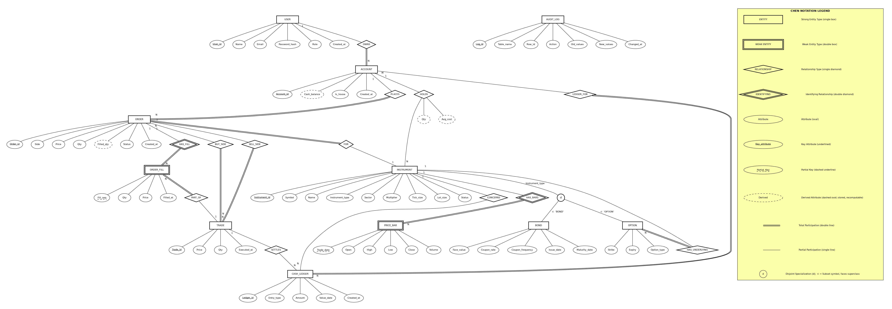
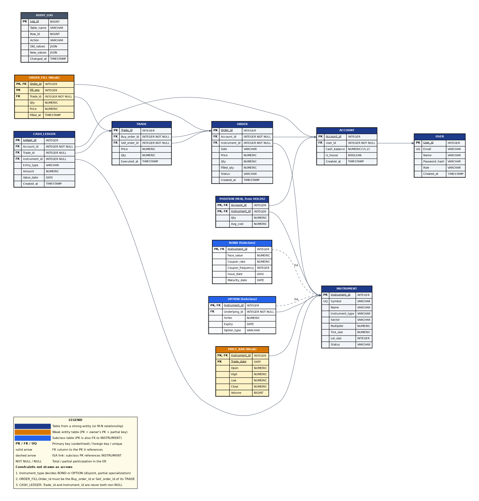

# Group 9 — Paper-Trading Exchange
## Mid-Semester Submission | CS F212 Database Systems, BITS Pilani Hyderabad

---

### 1. Database Design Document

#### 1.1 Assumptions

1. Only LIMIT orders are supported; no market orders. Every order has a positive price.
2. Short selling is out of scope; `POSITION.Qty >= 0` enforced. A "house" account holds initial inventory.
3. Stocks are instruments whose `instrument_type = 'STOCK'` with no subtype table (no extra attributes beyond INSTRUMENT). Bonds and Options each have their own subtype table.
4. AUDIT_LOG intentionally has no foreign keys so that audit history survives deletions.
5. Cash settlement formula is uniform: `settlement_amount = price × qty × multiplier`, where `multiplier` is set per instrument (1 for stocks, face_value/100 for bonds, contract-specific for options).

---

#### 1.2 ER/EER Diagram



*The diagram uses **Chen notation** (Elmasri & Navathe 7th ed.) with the following conventions:*

| Symbol | Meaning |
|---|---|
| Rectangle | Strong entity type (name in CAPITALS) |
| Double rectangle | Weak entity type |
| Diamond | Relationship type (verb in CAPITALS) |
| Double diamond | Identifying relationship |
| Oval | Attribute (Initial cap) |
| Underlined name in oval | Key attribute |
| Dashed underlined name | Partial key (weak entity) |
| Dashed oval | Derived attribute |
| Double line | Total participation |
| Single line | Partial participation |
| 1, M, N | Cardinality ratio |
| Circle with **d** | Disjoint EER specialization |
| Single line to circle | Partial specialization |
| ⊂ on subclass line | Subset symbol (opening faces superclass) |

**Entity types (11):** USER, ACCOUNT, INSTRUMENT (supertype), BOND (subclass), OPTION (subclass), ORDER, TRADE, ORDER_FILL (weak), PRICE_BAR (weak), CASH_LEDGER, AUDIT_LOG.

**Relationships (13):** OWNS, PLACES, FOR (order→instrument), HOLDS (M:N positions), BUY_SIDE, SELL_SIDE, HAS_FILL (identifying), PART_OF (fill→trade), HAS_BARS (identifying), LEDGER_FOR, SETTLES, CONCERNS (instrument→ledger entry), HAS_UNDERLYING.

**EER Specialization:** INSTRUMENT is specialized into BOND and OPTION. This is an **attribute-defined, disjoint, partial** specialization on `Instrument_type`:
- **Disjoint (d):** An instrument is in at most one subtype table (a stock is in neither; a bond is in BOND only; an option is in OPTION only).
- **Partial:** Not every instrument is in a subclass — stocks have `instrument_type = 'STOCK'` but no subtype table.
- **Attribute-defined:** The discriminating attribute is `Instrument_type` with values `'BOND'` and `'OPTION'` on the respective subclass lines.

**Derived attributes (dashed ovals):** `Cash_balance` (ACCOUNT), `Filled_qty` (ORDER), and `Qty` and `Avg_cost` on HOLDS can all be recomputed from CASH_LEDGER, ORDER_FILL and TRADE. They are drawn dashed in the ER and stored deliberately for performance (see 1.6).

**Weak entities:**
- **PRICE_BAR:** Cannot be identified without its parent INSTRUMENT. Partial key = `Trade_date`. Full identifier = (`Instrument_id`, `Trade_date`). Identifying relationship = HAS_BARS.
- **ORDER_FILL:** Cannot be identified without its parent ORDER. Partial key = `Fill_seq`. Full identifier = (`Order_id`, `Fill_seq`). Identifying relationship = HAS_FILL. This models partial order fills (one order filled across multiple trades).

---

#### 1.3 Relational Schema



Mapping follows the 9-step procedure from Elmasri & Navathe Ch. 9. Steps applied are noted in brackets.

**Step 1 — Regular (strong) entity types:**

- **USER**(<U>User_id</U>, Name, Email, Password_hash, Role, Created_at)
  - Email is a candidate key (UNIQUE).

- **ACCOUNT**(<U>Account_id</U>, User_id, Cash_balance, Is_house, Created_at)
  - User_id FK → USER.User_id [Step 4: binary 1:N OWNS]

- **INSTRUMENT**(<U>Instrument_id</U>, Symbol, Name, Instrument_type, Sector, Multiplier, Tick_size, Lot_size, Status)
  - Symbol is a candidate key (UNIQUE).
  - Instrument_type ∈ {'STOCK', 'BOND', 'OPTION'}

- **ORDER**(<U>Order_id</U>, Account_id, Instrument_id, Side, Price, Qty, Filled_qty, Status, Created_at)
  - Account_id FK → ACCOUNT.Account_id [Step 4: binary 1:N PLACES]
  - Instrument_id FK → INSTRUMENT.Instrument_id [Step 4: binary 1:N FOR]

- **TRADE**(<U>Trade_id</U>, Buy_order_id, Sell_order_id, Price, Qty, Executed_at)
  - Buy_order_id FK → ORDER.Order_id [Step 4: binary 1:N BUY_SIDE]
  - Sell_order_id FK → ORDER.Order_id [Step 4: binary 1:N SELL_SIDE]

- **CASH_LEDGER**(<U>Ledger_id</U>, Account_id, Trade_id, Instrument_id, Entry_type, Amount, Value_date, Created_at)
  - Account_id FK → ACCOUNT.Account_id [Step 4: binary 1:N LEDGER_FOR]
  - Trade_id FK → TRADE.Trade_id (nullable) [Step 4: binary 1:N SETTLES, partial on CASH_LEDGER]
  - Instrument_id FK → INSTRUMENT.Instrument_id (nullable) [Step 4: binary 1:N CONCERNS, partial on CASH_LEDGER; used by instrument-linked entries such as COUPON, never together with Trade_id]
  - Entry_type ∈ {'DEPOSIT', 'WITHDRAWAL', 'BUY', 'SELL', 'FEE', 'COUPON', 'REDEMPTION', 'EXERCISE'}

- **AUDIT_LOG**(<U>Log_id</U>, Table_name, Row_id, Action, Old_values, New_values, Changed_at)
  - No FK on Row_id (by design, so history survives deletes).

**Step 2 — Weak entity types:**

- **PRICE_BAR**(<U>Instrument_id, Trade_date</U>, Open, High, Low, Close, Volume)
  - Instrument_id FK → INSTRUMENT.Instrument_id [Step 2: identifying relationship HAS_BARS]
  - PK = owner key + partial key = {Instrument_id, Trade_date}

- **ORDER_FILL**(<U>Order_id, Fill_seq</U>, Trade_id, Qty, Price, Filled_at)
  - Order_id FK → ORDER.Order_id [Step 2: identifying relationship HAS_FILL]
  - Trade_id FK → TRADE.Trade_id [Step 4: binary N:1 PART_OF, total on ORDER_FILL]
  - PK = owner key + partial key = {Order_id, Fill_seq}

**Step 5 — Binary M:N relationships:**

- **POSITION**(<U>Account_id, Instrument_id</U>, Qty, Avg_cost)
  - Account_id FK → ACCOUNT.Account_id
  - Instrument_id FK → INSTRUMENT.Instrument_id
  - PK = combination of both FKs [Step 5: M:N HOLDS, with relationship attributes Qty, Avg_cost]

**Step 8 — EER Specialization (option 8A: superclass relation + one relation per subclass):**

Specialization is partial + disjoint → legal options are 8A, 8C, 8D.
We choose **8A** (superclass relation + one relation per subclass) because:
- It avoids NULLs entirely (8C/8D would have many NULLs for non-bond/non-option instruments).
- Requires a join to access subtype attributes, but this is infrequent (matching and settlement use only INSTRUMENT).

- **BOND**(<U>Instrument_id</U>, Face_value, Coupon_rate, Coupon_frequency, Issue_date, Maturity_date)
  - Instrument_id PK and FK → INSTRUMENT.Instrument_id

- **OPTION**(<U>Instrument_id</U>, Underlying_id, Strike, Expiry, Option_type)
  - Instrument_id PK and FK → INSTRUMENT.Instrument_id
  - Underlying_id FK → INSTRUMENT.Instrument_id [from HAS_UNDERLYING relationship]
  - Option_type ∈ {'CALL', 'PUT'}

**Summary — 12 relations total:**

| # | Relation | PK | Step |
|---|---|---|---|
| 1 | USER | User_id | 1 |
| 2 | ACCOUNT | Account_id | 1 + 4 (OWNS FK) |
| 3 | INSTRUMENT | Instrument_id | 1 |
| 4 | BOND | Instrument_id | 8A |
| 5 | OPTION | Instrument_id | 8A + 4 (HAS_UNDERLYING FK) |
| 6 | PRICE_BAR | (Instrument_id, Trade_date) | 2 |
| 7 | ORDER | Order_id | 1 + 4 (PLACES, FOR FKs) |
| 8 | TRADE | Trade_id | 1 + 4 (BUY_SIDE, SELL_SIDE FKs) |
| 9 | ORDER_FILL | (Order_id, Fill_seq) | 2 + 4 (PART_OF FK) |
| 10 | POSITION | (Account_id, Instrument_id) | 5 (M:N HOLDS) |
| 11 | CASH_LEDGER | Ledger_id | 1 + 4 (LEDGER_FOR, SETTLES, CONCERNS FKs) |
| 12 | AUDIT_LOG | Log_id | 1 |

---

#### 1.4 Primary and Foreign Keys

**Primary Keys:**
- Surrogate keys: USER(User_id), ACCOUNT(Account_id), INSTRUMENT(Instrument_id), ORDER(Order_id), TRADE(Trade_id), CASH_LEDGER(Ledger_id), AUDIT_LOG(Log_id)
- Composite keys: PRICE_BAR(Instrument_id, Trade_date), ORDER_FILL(Order_id, Fill_seq), POSITION(Account_id, Instrument_id)
- Subtype shared keys: BOND(Instrument_id), OPTION(Instrument_id)

**Foreign Keys (16 total):**

| FK Column(s) | In Relation | References |
|---|---|---|
| User_id | ACCOUNT | USER(User_id) |
| Account_id | ORDER | ACCOUNT(Account_id) |
| Instrument_id | ORDER | INSTRUMENT(Instrument_id) |
| Buy_order_id | TRADE | ORDER(Order_id) |
| Sell_order_id | TRADE | ORDER(Order_id) |
| Account_id | CASH_LEDGER | ACCOUNT(Account_id) |
| Trade_id | CASH_LEDGER | TRADE(Trade_id) |
| Instrument_id | CASH_LEDGER | INSTRUMENT(Instrument_id) |
| Instrument_id | PRICE_BAR | INSTRUMENT(Instrument_id) |
| Order_id | ORDER_FILL | ORDER(Order_id) |
| Trade_id | ORDER_FILL | TRADE(Trade_id) |
| Account_id | POSITION | ACCOUNT(Account_id) |
| Instrument_id | POSITION | INSTRUMENT(Instrument_id) |
| Instrument_id | BOND | INSTRUMENT(Instrument_id) |
| Instrument_id | OPTION | INSTRUMENT(Instrument_id) |
| Underlying_id | OPTION | INSTRUMENT(Instrument_id) |

---

#### 1.5 Important Integrity Constraints

**CHECK constraints:**
- `ACCOUNT.Cash_balance >= 0` — prevents overdrawing
- `ORDER.Price > 0`, `ORDER.Qty > 0` — valid limit orders only
- `ORDER.Filled_qty BETWEEN 0 AND ORDER.Qty` — fill never exceeds order size
- `ORDER.Side IN ('BUY', 'SELL')`
- `ORDER.Status IN ('OPEN', 'PARTIAL', 'FILLED', 'CANCELLED')`
- `TRADE.Price > 0`, `TRADE.Qty > 0`
- `PRICE_BAR.High >= PRICE_BAR.Low`, `PRICE_BAR.Open > 0`, `PRICE_BAR.Close > 0`
- `CASH_LEDGER.Amount <> 0` — no zero-value entries
- `INSTRUMENT.Multiplier > 0`, `INSTRUMENT.Tick_size > 0`, `INSTRUMENT.Lot_size > 0`
- `INSTRUMENT.Status IN ('ACTIVE', 'HALTED', 'EXPIRED')`
- `INSTRUMENT.Instrument_type IN ('STOCK', 'BOND', 'OPTION')`
- `BOND.Face_value > 0`, `BOND.Coupon_rate >= 0`
- `BOND.Coupon_frequency IN (1, 2, 4, 12)`
- `BOND.Maturity_date > BOND.Issue_date`
- `OPTION.Strike > 0`
- `OPTION.Option_type IN ('CALL', 'PUT')`
- `POSITION.Qty >= 0`, `POSITION.Avg_cost >= 0`

**UNIQUE constraints:**
- `USER.Email`
- `INSTRUMENT.Symbol`
- `CASH_LEDGER(Account_id, Instrument_id, Entry_type, Value_date)` — idempotence: prevents double coupon/redemption payouts

**NOT NULL:**
- All PK and FK columns (except CASH_LEDGER.Trade_id and CASH_LEDGER.Instrument_id which are nullable)
- USER.Name, USER.Email, USER.Password_hash
- All TRADE columns, all ORDER columns

**Constraints NOT enforceable by PK/FK alone (require triggers or application logic):**

| Constraint | Enforcement |
|---|---|
| Subtype disjointness: a row in BOND or OPTION must match INSTRUMENT.Instrument_type | Trigger on INSERT into BOND/OPTION checks Instrument_type |
| Orders on EXPIRED instruments rejected | Trigger on INSERT into ORDER checks Instrument.Status |
| BUY_SIDE and SELL_SIDE orders in a TRADE must be for the same instrument and opposite sides | Trigger on INSERT into TRADE |
| An ORDER_FILL's `Order_id` must be the `Buy_order_id` or `Sell_order_id` of its `Trade_id` | Trigger on INSERT into ORDER_FILL |
| Totality of ACCOUNT participation in OWNS (every ACCOUNT must have a User_id) | NOT NULL + FK suffices here |
| `CASH_LEDGER.Trade_id` and `CASH_LEDGER.Instrument_id` are never both non-NULL | CHECK constraint: `NOT (Trade_id IS NOT NULL AND Instrument_id IS NOT NULL)` |
| `ORDER.Filled_qty` equals the sum of its ORDER_FILL.Qty values | Trigger on INSERT into ORDER_FILL |
| `ACCOUNT.Cash_balance` and `POSITION.Qty` stay consistent with CASH_LEDGER/TRADE | Maintained inside an ACID transaction with SELECT ... FOR UPDATE |

---

#### 1.6 Normalization and Design Justification

The schema is in **BCNF** (Boyce-Codd Normal Form). Every non-trivial functional dependency has a superkey as its determinant.

**Normalization analysis of key relations:**

- **TRADE**: The original brief omitted `Instrument_id` (derivable from the two order FKs), deliberately keeping 3NF. We retain this decision — the redundancy would be controlled if added, but without it there is no transitive dependency.
- **POSITION(Account_id, Instrument_id, Qty, Avg_cost)**: Qty and Avg_cost are derivable from TRADE/ORDER_FILL data. This is **deliberate denormalization** for performance — recalculating from the full trade history on every portfolio query is expensive. Correctness is maintained inside the settlement transaction (the same transaction that creates a TRADE also updates POSITION under a row-level lock).
- **ACCOUNT.Cash_balance**: Similarly derivable from CASH_LEDGER. Same justification — maintained atomically within the settlement transaction.
- **ORDER.Filled_qty**: Derivable from the sum of ORDER_FILL.Qty. Maintained by a trigger on ORDER_FILL insertion. Avoids an expensive aggregate on every order-book query.

**Why these denormalizations are acceptable:**
1. The source-of-truth tables exist (CASH_LEDGER, ORDER_FILL, TRADE).
2. The denormalized values are updated in the same ACID transaction that writes to the source tables.
3. An invariant-check query can verify consistency at any time (useful for the concurrency stress test).

**EER specialization choice (8A):**
- Partial + Disjoint → Options are 8A, 8C, 8D.
- 8A chosen to avoid NULLs (stocks would have many NULL bond/option columns under 8C/8D).

---

### 2. Application Design

#### 2.1 Proposed Application Workflows

**Workflow 1 — Place, Match, and Settle an Order (Transaction-heavy)**

A user submits a LIMIT order via the UI. The backend calls a PL/pgSQL stored procedure `match_and_settle(order_id)` which, in a single SERIALIZABLE transaction:
1. Validates the order (instrument not expired, sufficient cash/holdings).
2. Finds the best matching resting order on the opposite side (price-time priority: best price first, earliest `created_at` for ties).
3. Computes fill quantity (min of the two remaining quantities).
4. Inserts a TRADE row, two ORDER_FILL rows (one per order), updates both ORDER.Filled_qty and Status.
5. Updates POSITION for both accounts (insert or update Qty and Avg_cost).
6. Inserts two CASH_LEDGER entries (debit buyer, credit seller: `amount = ±price × qty × multiplier`).
7. Updates both ACCOUNT.Cash_balance.
8. If the incoming order is not fully filled, loops to step 2.
All under `SELECT ... FOR UPDATE` on the relevant ACCOUNT and POSITION rows to prevent concurrent corruption.

**Workflow 2 — Portfolio Dashboard and P&L Report (Complex Retrieval)**

A CTE-based query joins POSITION with INSTRUMENT and the latest PRICE_BAR (using a lateral join or window function for the most recent close price per instrument) to compute:
- Current market value per position
- Unrealized P&L = (current_price − avg_cost) × qty × multiplier
- Total portfolio value = sum of cash_balance + sum of market values
- Aggregation by instrument type (stocks vs bonds vs options)

Uses: CTEs, window functions (ROW_NUMBER to get latest price bar), multi-table JOINs, aggregate functions.

**Workflow 3 — Constraint Enforcement Demonstration**

Demonstrate the database rejecting invalid operations:
1. **Overspend:** Try to place a buy order when the account has insufficient cash → ACCOUNT.Cash_balance CHECK fails.
2. **Oversell:** Try to sell more than owned → POSITION.Qty CHECK fails (qty would go negative).
3. **Expired instrument:** Try to order an instrument with Status = 'EXPIRED' → Trigger rejects.
4. **Wrong subtype:** Try to INSERT into BOND where Instrument_type = 'STOCK' → Trigger rejects.
5. **Double coupon payout:** Try to insert a duplicate COUPON ledger entry for the same bond on the same date → UNIQUE constraint on CASH_LEDGER(Account_id, Instrument_id, Entry_type, Value_date) fails.

#### 2.2 Technology Stack

| Layer | Technology | Rationale |
|---|---|---|
| **Database** | PostgreSQL 16 | ACID compliance, JSONB (for audit_log), advanced triggers/functions, partial indexes, SERIALIZABLE isolation |
| **Backend** | FastAPI (Python) with psycopg3 | Raw SQL queries (no ORM) to fully demonstrate SQL and DBMS features |
| **Frontend** | Streamlit or React | Thin UI for the trading dashboard, order entry, and portfolio view |
| **Data loading** | COPY from CSV | NSE bhavcopy for stock price history; synthetic bond prices from yield curves; synthetic option prices from Black-Scholes on underlying stock history |
| **Reproducibility** | Docker Compose | Single `docker-compose up` to start PostgreSQL + app |

#### 2.3 High-Level Application Architecture

```
┌─────────────────────────────────────────────────────┐
│                   CLIENT LAYER                      │
│   Web Browser (Streamlit / React)                   │
│   - Trading dashboard & order entry                 │
│   - Portfolio & P&L view                            │
│   - Instrument browser & price charts               │
└──────────────────────┬──────────────────────────────┘
                       │ REST / JSON
┌──────────────────────▼──────────────────────────────┐
│                APPLICATION LAYER                    │
│   FastAPI Backend (Python)                          │
│   - Input validation & auth                         │
│   - Calls stored procedures for order matching      │
│   - Translates queries into raw SQL                 │
│   - No ORM — all SQL hand-written                   │
└──────────────────────┬──────────────────────────────┘
                       │ Raw SQL via psycopg3
┌──────────────────────▼──────────────────────────────┐
│                 DATABASE LAYER                      │
│   PostgreSQL 16                                     │
│   - 12 relations (schema above)                     │
│   - Stored proc: match_and_settle()                 │
│   - Triggers: audit_log, subtype enforcement,       │
│     trade/order validation, fill_qty sync           │
│   - Views: order_book, portfolio_summary            │
│   - Partial index on open orders                    │
│   - SERIALIZABLE transactions with row locking      │
└─────────────────────────────────────────────────────┘
```

---

### 3. DBMS Features Plan

| Feature | Implementation | Count |
|---|---|---|
| **Transactions** | Order matching + settlement in one SERIALIZABLE transaction with `SELECT ... FOR UPDATE` | 1 |
| **Triggers** | (1) Audit log auto-population on INSERT/UPDATE/DELETE, (2) Subtype disjointness enforcement, (3) Trade validation (same instrument, opposite sides), (4) Order rejection on expired instruments, (5) Filled_qty sync on ORDER_FILL insert | 5 |
| **Views** | (1) `order_book_view`: open orders aggregated by price level, (2) `portfolio_view`: positions with current market value and P&L | 2 |
| **Stored procedures/functions** | (1) `match_and_settle(order_id)`: the complete matching engine, (2) `end_of_day()`: pays coupons, redeems bonds, settles options at expiry | 2 |
| **Indexes** | (1) Partial index on `ORDER(instrument_id, side, price, created_at) WHERE status IN ('OPEN', 'PARTIAL')` for fast order-book lookups, (2) Index on `PRICE_BAR(instrument_id, trade_date DESC)` for latest-price queries | 2 |

**Total: 5 distinct DBMS feature categories** (requirement: ≥ 3).

---

### 4. Non-Trivial SQL Queries Plan

| # | Query | SQL Concepts |
|---|---|---|
| 1 | Order book depth: aggregate open orders by instrument, side, price level with running total | GROUP BY, SUM, window function (RUNNING SUM) |
| 2 | Portfolio value: latest close price per instrument via CTE + lateral join, then compute MV and P&L | CTE, LATERAL JOIN, aggregate |
| 3 | Realized P&L per account: join trades with order_fills, compute buy vs sell proceeds | Multi-table JOIN, aggregate, CASE |
| 4 | Rolling 30-day return and max drawdown per instrument | Window functions (LAG, MIN OVER) |
| 5 | VWAP (volume-weighted average price) per stock per day | JOIN, weighted average, GROUP BY |
| 6 | Accounts whose total holdings value exceeds cash balance | Correlated subquery, aggregate |
| 7 | Bond yield-to-maturity approximation | Stored function, math |

**Total: 7 planned queries** (requirement: ≥ 5).

---

### 5. GitHub Repository

- **Project Title:** Paper-Trading Exchange
- **Description:** A full-stack paper trading platform simulating a financial exchange with order matching, multi-instrument support (stocks, bonds, options), settlement, portfolio management, and an audit trail. Built on PostgreSQL with a focus on database design depth.
- **Current Progress:** ER/EER modeling completed. Relational schema defined with 12 relations including ISA hierarchy (partial, disjoint), two weak entities, and one M:N relationship. Graphviz Chen-notation diagram produced.
- **Team Members & Contributions:**
  - **Devansh Rupesh Anadkat** (ID: `2024ADPS0198H`): Author of the conceptual ER/EER model (Chen notation), EER disjoint specialization hierarchy (`BOND`/`OPTION`), 9-step relational schema mapping procedure, and transaction stored procedure design (`match_and_settle`).
  - **Akarsh Ramadugu** (ID: `2024ADPS0196H`): BCNF normalization proof, design performance trade-off justifications, formulation of non-trivial SQL analytics queries, partial index strategy, and database view specifications.
  - **Shashank Bodala** (ID: `2024ADPS0186H`): Definition of database integrity constraints (`CHECK`, `UNIQUE`, `NOT NULL`) and trigger logic specifications (audit logging, subtype disjointness, fill sync).
  - **Druhin Sourya Datta Bommisetti** (ID: `2024ADPS0182H`): Application design specifications, high-level architecture layout, and definition of the 3 core application workflows.
  - **Hakimkari Sathvika** (ID: `2024ADPS0192H`): Data loading strategy planning (COPY ingestion), synthetic pricing formulas (Black-Scholes & yield curves), and GitHub repository structure.
